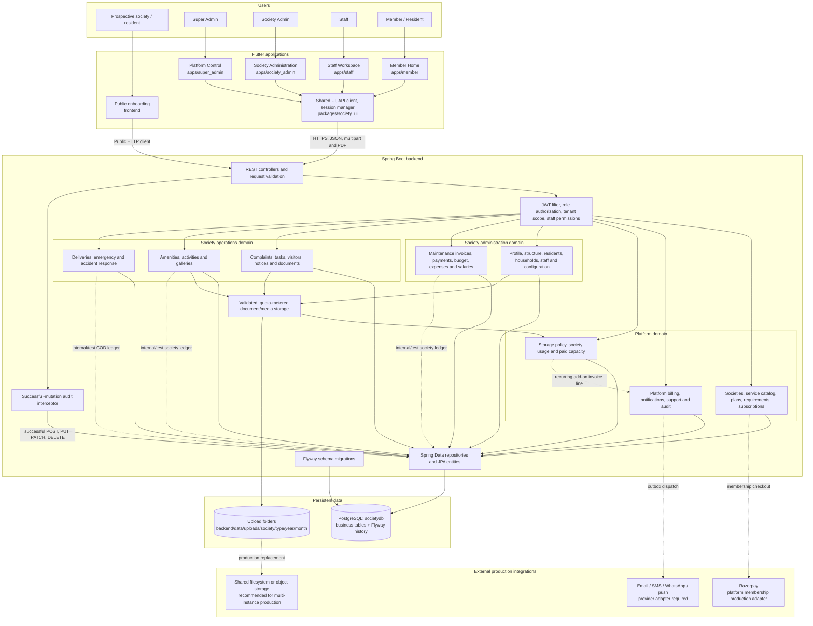
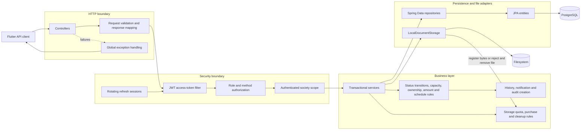
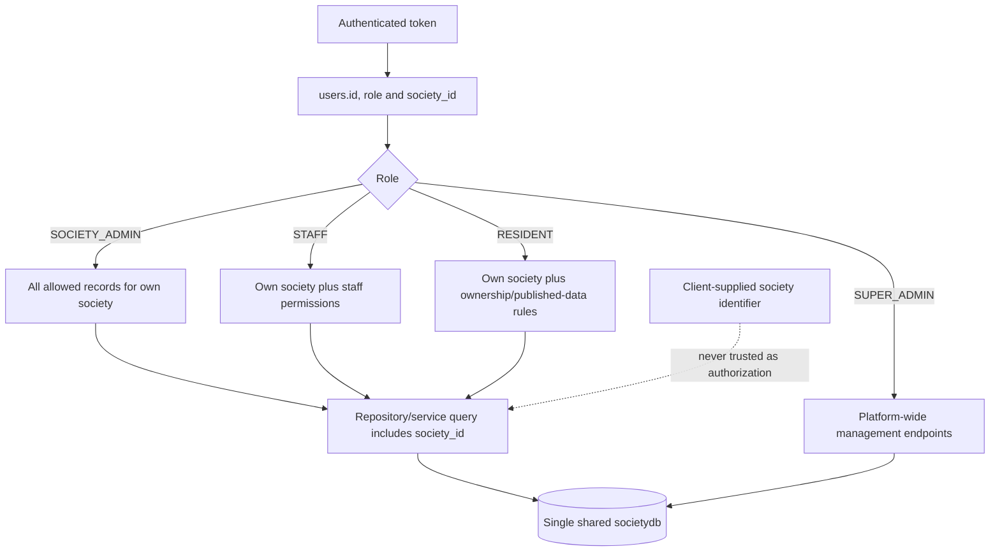
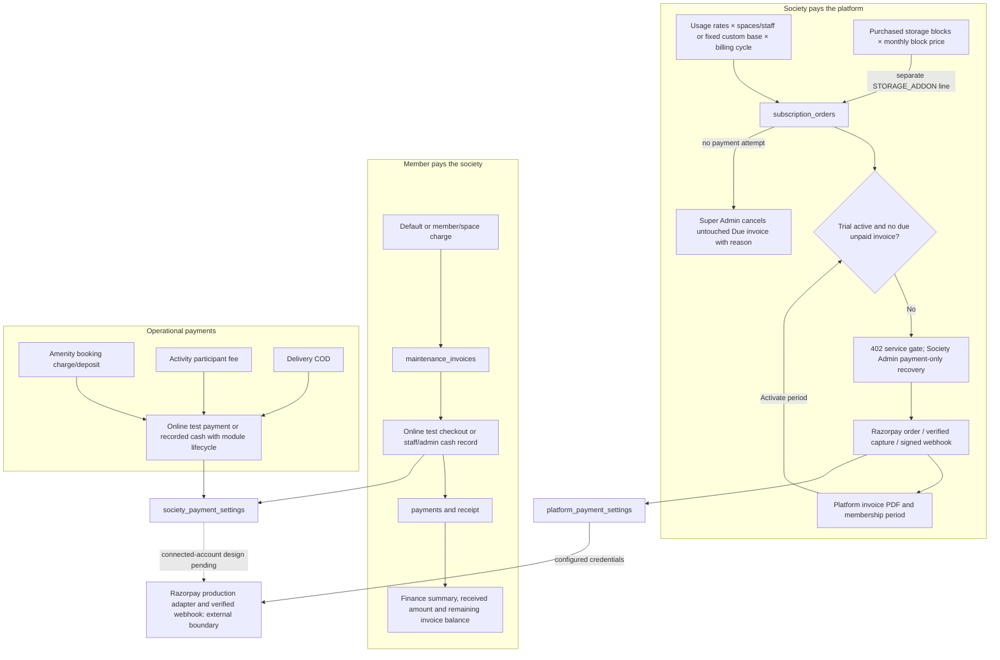
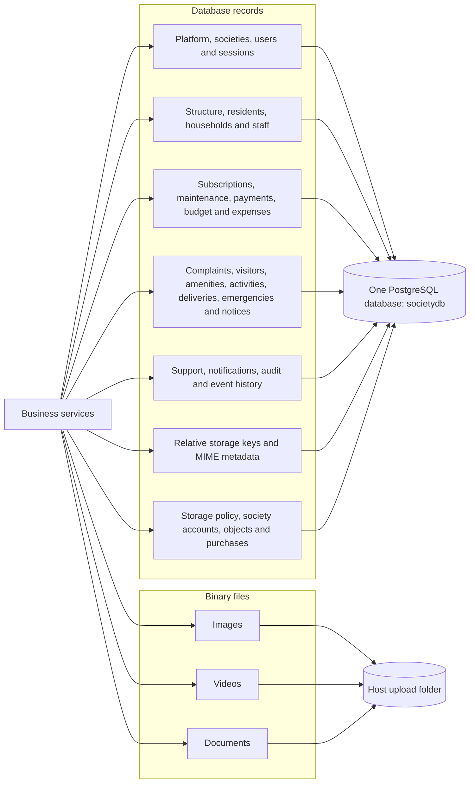
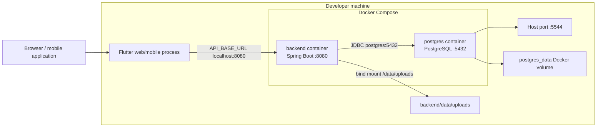
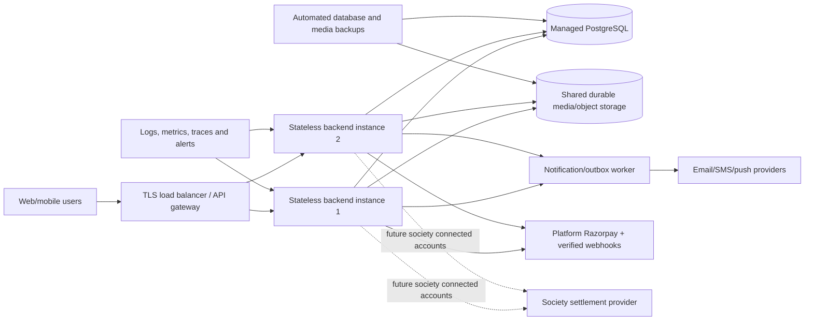
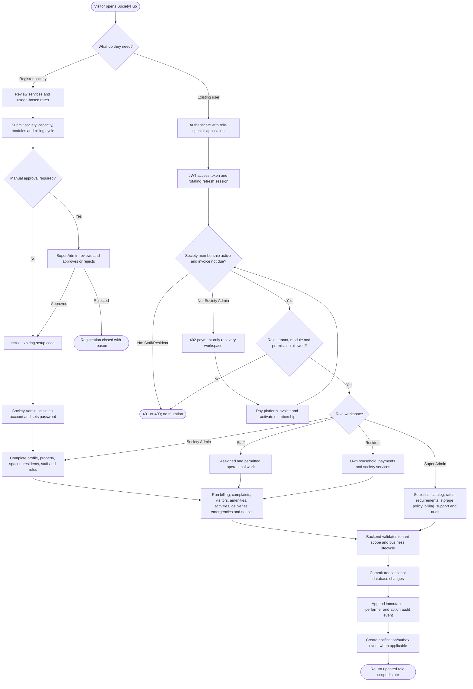
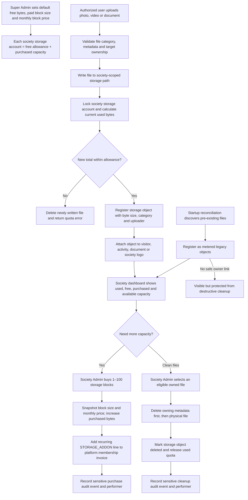

# Complete Application Architecture Diagram

This document shows how the complete SocietyHub application is assembled. For business-state
flows and the detailed database ER model, see
[Complete Application Flow and Database Structure](COMPLETE_APPLICATION_FLOW_AND_DATABASE.md).

## Rendered flowchart assets

- [Complete application and configuration flowchart — PNG](diagrams/complete_application_configuration_flowchart.png)
- [Complete application and configuration flowchart — zoomable SVG](diagrams/complete_application_configuration_flowchart.svg)
- [Detailed society configuration flowchart — PNG](diagrams/society_configuration_detail_flowchart.png)
- [Detailed society configuration flowchart — zoomable SVG](diagrams/society_configuration_detail_flowchart.svg)
- [Complete database structure flowchart — PNG](diagrams/complete_database_structure_flowchart.png)
- [Complete database structure flowchart — zoomable SVG](diagrams/complete_database_structure_flowchart.svg)

The PNG files are convenient for sharing in chat or presentations. Use the SVG versions for
zooming, printing, or editing without losing text quality.

## 1. Master application diagram



## 2. Application-to-module diagram

```mermaid
flowchart LR
    subgraph Apps["Role applications"]
        SA["Super Admin"]
        OA["Society Admin"]
        ST["Staff"]
        MB["Member"]
    end

    subgraph Platform["Platform modules"]
        Societies["Societies and activation"]
        Catalog["Services and subscription rates"]
        Requirements["Custom requirements"]
        Membership["Platform membership billing"]
        PlatformSupport["Notifications, support and audit"]
        StorageAdmin["Free allowance, paid block size, price and society usage"]
    end

    subgraph Masters["Society master modules"]
        Profile["Profile and enabled services"]
        Property["Property spaces"]
        Residents["Residents and households"]
        Staff["Staff, attendance and salary"]
        Config["Parking, vendors, categories and charges"]
        SocietyStorage["Storage usage, purchases and safe cleanup"]
    end

    subgraph Finance["Society finance modules"]
        Billing["Budget and expenses"]
        Payments["Invoices, payments and receipts"]
    end

    subgraph Operations["Operational modules"]
        Complaints["Complaints and tasks"]
        Visitors["Visitors"]
        Amenities["Amenities and bookings"]
        Activities["Activities and galleries"]
        Deliveries["Deliveries and COD"]
        Emergency["Emergency and accidents"]
        Notices["Notices and documents"]
    end

    SA --> Societies
    SA --> Catalog
    SA --> Requirements
    SA --> Membership
    SA --> PlatformSupport
    SA --> StorageAdmin

    OA --> Profile
    OA --> Property
    OA --> Residents
    OA --> Staff
    OA --> Config
    OA --> SocietyStorage
    OA --> Billing
    OA --> Payments
    OA --> Complaints
    OA --> Visitors
    OA --> Amenities
    OA --> Activities
    OA --> Deliveries
    OA --> Emergency
    OA --> Notices

    ST --> Staff
    ST --> Payments
    ST --> Complaints
    ST --> Visitors
    ST --> Amenities
    ST --> Activities
    ST --> Deliveries
    ST --> Emergency
    ST --> Notices
    ST --> Residents

    MB --> Residents
    MB --> Payments
    MB --> Complaints
    MB --> Visitors
    MB --> Amenities
    MB --> Activities
    MB --> Deliveries
    MB --> Emergency
    MB --> Notices
```



Society Admin navigation is filtered by `societies.enabled_modules`. Staff actions are further
filtered by role, tenant, ownership and `staff_permissions`. Members receive only their own or
published society data.

## 3. Backend component diagram



## 4. Multi-tenant data boundary



The database is shared, but society data is logically isolated. A normal society user cannot
select another society merely by changing a request identifier.

## 5. Payment architecture



## 6. Persistence diagram



## 7. Local deployment diagram



## 8. Production deployment direction



The production diagram is the recommended operational target. The repository currently runs a
single backend, PostgreSQL container, host upload folder, Razorpay integration and notification
outbox without an external dispatcher.

## 9. Repository mapping

| Diagram component | Repository location |
| --- | --- |
| Public onboarding | `frontend` |
| Role applications | `apps/super_admin`, `apps/society_admin`, `apps/staff`, `apps/member` |
| Shared Flutter layer | `packages/society_ui` |
| Controllers | `backend/src/main/java/com/societyapp/controller` |
| Authentication/security | `backend/src/main/java/com/societyapp/auth`, `backend/src/main/java/com/societyapp/security` |
| Business services | `backend/src/main/java/com/societyapp/service` |
| Persistence | `backend/src/main/java/com/societyapp/repository`, `backend/src/main/java/com/societyapp/entity` |
| Upload storage | `backend/src/main/java/com/societyapp/documents`, `backend/data/uploads` |
| Database migrations | `backend/src/main/resources/db/migration` |
| Local deployment | `docker-compose.yml` |

## 10. Complete business flow



## 11. Storage quota, purchase and cleanup flow



## 12. Sensitive activity and audit flow

```mermaid
sequenceDiagram
    actor Actor as Authenticated user
    participant API as Secured API
    participant Domain as Business service
    participant DB as PostgreSQL transaction
    participant Audit as Audit mutation interceptor
    actor SocietyAdmin as Society Admin
    actor SuperAdmin as Super Admin

    Actor->>API: POST / PUT / PATCH / DELETE
    API->>API: Validate JWT, role, society, module and permission
    API->>Domain: Execute validated command
    Domain->>DB: Commit successful change
    DB-->>Domain: Saved result
    Domain-->>API: Success response
    API->>Audit: Capture route, action, entity, actor and society snapshot
    Audit->>DB: Append immutable audit event
    API-->>Actor: Return success

    SocietyAdmin->>API: View own society sensitive activity
    API->>DB: Tenant-scoped filtered query
    DB-->>SocietyAdmin: Performer, action, target, time and safe details

    SuperAdmin->>API: Search platform audit log
    API->>DB: Platform-wide filtered and paginated query
    DB-->>SuperAdmin: Cross-society audit results
```

Audit records are created only after successful mutations. Failed validation, authentication,
authorization, or rolled-back transactions do not appear as completed platform changes.
