# Complete Application Flow and Database Structure

This document explains the implemented SocietyHub application as one connected system. It
covers the five Flutter entry points, role and module controls, business workflows, the Spring
Boot API, filesystem uploads, and the single PostgreSQL database.

## 1. System at a glance

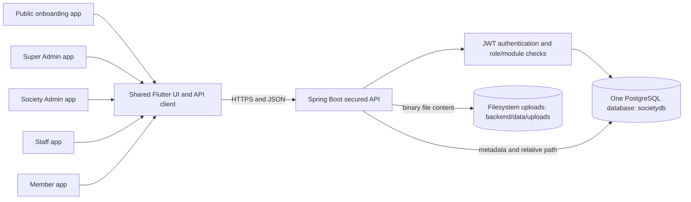

The important separation is:

- PostgreSQL stores users, societies, statuses, amounts, relationships, audit history, and file
  metadata.
- The filesystem stores the actual bytes of photos, videos, and documents.
- Every society-owned business record is scoped directly or indirectly to one `society_id`.
- Super Admin operates the platform. Society Admin, Staff, and Member operate inside a society.

## 2. How a request works

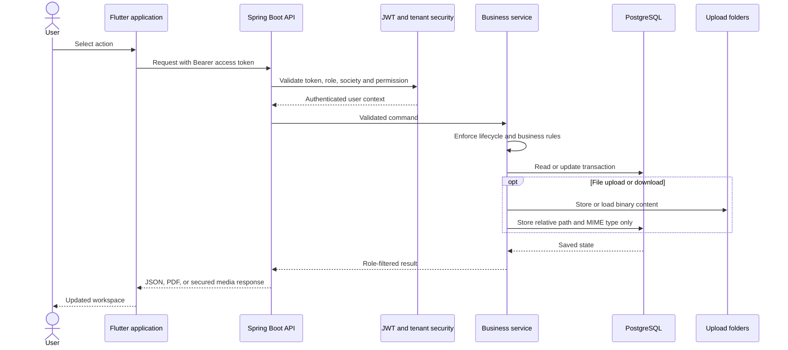

## 3. Applications and responsibilities

| Application | Role | Main functionality |
| --- | --- | --- |
| Public onboarding (`frontend`) | Public | View services/plans, register a society, submit custom requirements, activate a society, register as a resident |
| Platform Control (`apps/super_admin`) | `SUPER_ADMIN` | Platform dashboard, societies, service catalog, subscription rates, custom requirements, platform billing, storage policy/usage, notification outbox, support, audit |
| Society Administration (`apps/society_admin`) | `SOCIETY_ADMIN` | Society setup, property spaces, residents, households, staff, finance, payments, storage usage/purchase/cleanup, sensitive activity, and all enabled operational modules |
| Staff Workspace (`apps/staff`) | `STAFF` | Own profile/attendance, assigned duties, operational desks, collections, verification and response workflows allowed by permissions |
| Member Home (`apps/member`) | `RESIDENT` | Own invoices/payments, complaints, visitors, bookings, activities, deliveries, notices, household, emergency reporting |

### Role-to-module view

| Function | Member | Staff | Society Admin | Super Admin |
| --- | :---: | :---: | :---: | :---: |
| Platform plans and service catalog | View public selection | — | View/pay own membership | Configure |
| Society approval and activation | — | — | Activate approved society | Approve/reject/manage |
| Property groups, sections and spaces | View own space context | View operational context | Manage | View aggregate |
| Residents and households | Own household | Verify when permitted | Manage all | Aggregate only |
| Staff/profile/attendance/salary | — | Own profile and attendance | Manage all | Capacity aggregate |
| Society billing and payments | Pay/view own | Record collections | Configure, invoice, reconcile | Aggregate only |
| Complaints | Raise/follow | Work assigned complaints | Manage/assign | Aggregate only |
| Visitors | Pre-register/approve | Gate workflow | Manage | Aggregate only |
| Amenities | Book/pay | Operate bookings | Configure/manage | Aggregate only |
| Activities and galleries | Join/pay/submit photos | Operate registrations | Configure/moderate | Aggregate only |
| Deliveries | Expect/approve/pay COD/collect | Log and hand over | Manage | Aggregate only |
| Emergency and accidents | Report/follow | Respond | Coordinate/manage directory | Aggregate only |
| Notices | Read/acknowledge | Read or publish with access | Publish/manage | Aggregate only |
| Documents | Own registration documents | Limited operational use | Upload/manage | Verify platform-side |
| Storage capacity | Consume through uploads | Consume through permitted uploads | View, purchase and safely clean | Configure and monitor all societies |
| Audit and sensitive activity | — | — | View own society sensitive actions | Search platform-wide audit history |
| Support | — | — | Open/chat on ticket | Respond/resolve |

### Current navigation map

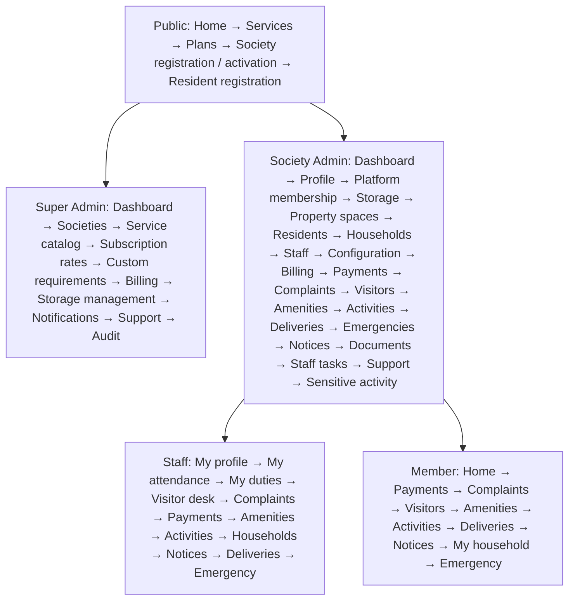

The arrows show how users enter the platform and are then managed; they do not mean one role can
open another role's application without the correct account.

### Enabled society service codes

| Service code | Enables or controls |
| --- | --- |
| `RWA` | Society application offering shown in the Super Admin service catalog |
| `RESIDENTS` | Residents and household management |
| `STAFF` | Staff profiles, permissions, attendance, salary and tasks |
| `VISITORS` | Resident approval and gate visitor operations |
| `COMPLAINTS` | Complaint categories, assignment, SLA and resolution |
| `BILLING` | Society budget, expenses, salaries and charge configuration |
| `PAYMENTS` | Maintenance invoices, collections and receipts |
| `AMENITIES` | Multiple facilities, booking and facility payments |
| `NOTICES` | Notices, audience filtering, reads and acknowledgement |
| `DOCUMENTS` | Society and registration documents |
| `PARKING` | Parking configuration |
| `VENDORS` | Vendor configuration |
| `DELIVERIES` | Parcel, COD and collection workflow |
| `EMERGENCY_INCIDENTS` | Emergency directory, incidents and response timeline |
| `ACTIVITIES_GALLERIES` | Free/paid activities, participation, attendance and galleries |

## 4. Access-control flow

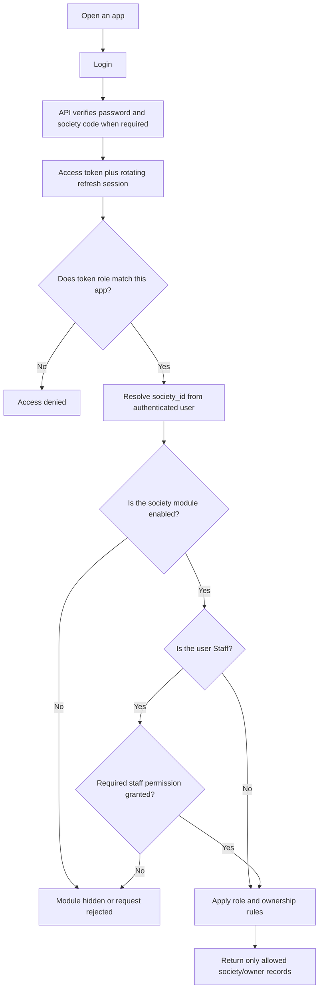

There are three complementary controls:

1. **Role control** determines which kind of operation a user may perform.
2. **Module control** uses `societies.enabled_modules` to determine which purchased services are
   available to that society.
3. **Staff permission control** uses `staff_permissions` for operational responsibilities inside
   the society.

## 5. Complete platform and society onboarding flow

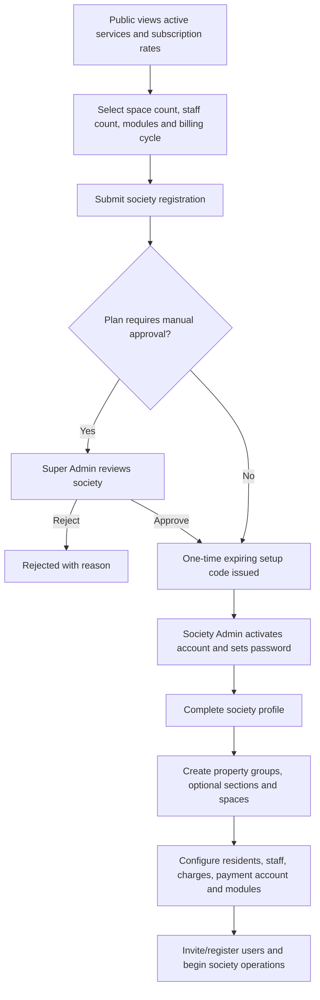

If standard rates do not fit, the public user can submit a requirement request. Super Admin can
contact the society and build a custom plan containing modules, capacity, storage, price, setup
fee, and validity dates.

## 6. Platform membership flow

Platform membership is money paid **by a society to the SocietyHub platform**. It is separate
from maintenance money paid **by residents to their society**.

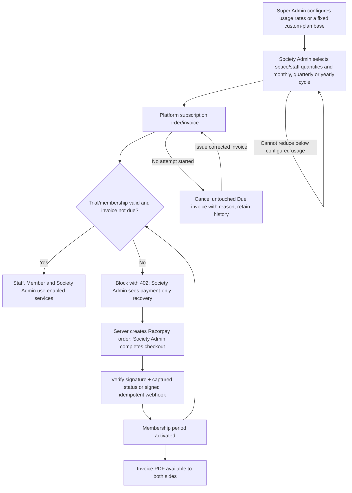

Platform membership payments use server-created Razorpay orders, capture validation, signed
webhooks, and idempotent payment attempts. Request-time entitlement checks prevent an existing JWT
from bypassing expiry or a due unpaid invoice. A fixed custom-plan base is billed once per month;
legacy `price_monthly` contracts are preserved when usage rates are zero. Society-level collections
for maintenance, amenities, activities, and deliveries remain a separate test-mode settlement
boundary.

## 7. Society setup dependency flow

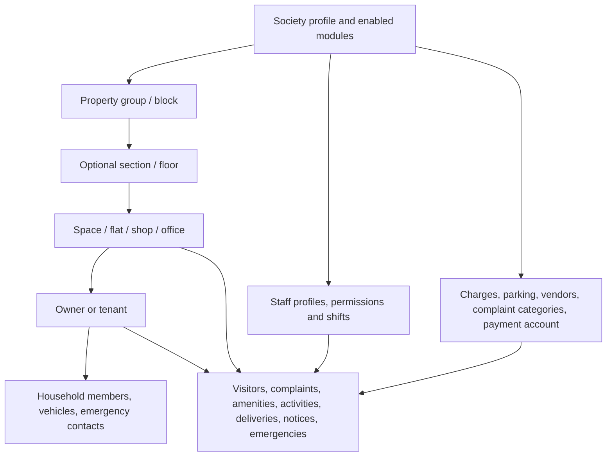

The public term is **space**. Some database tables retain the older names `floors` and `flats` to
avoid destructive migration; API aliases translate these into sections and spaces.

## 8. Resident and household flow

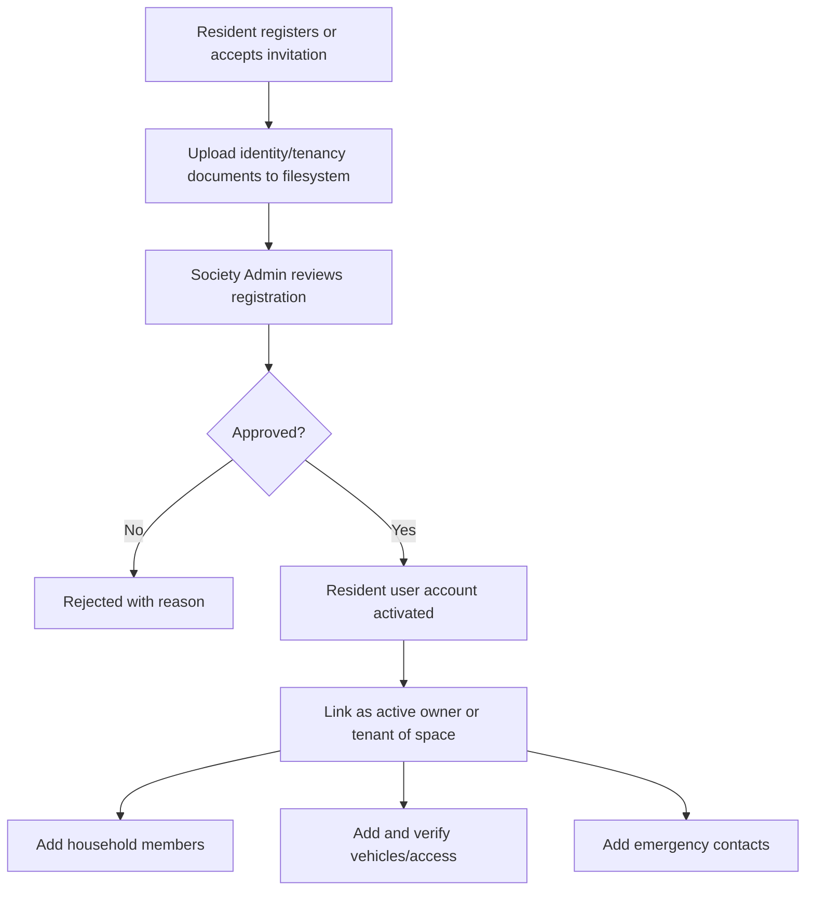

A space can have at most one active owner and one active tenant. Household records belong to the
primary resident and society; Society Admin or authorized staff can verify them.

## 9. Staff management flow

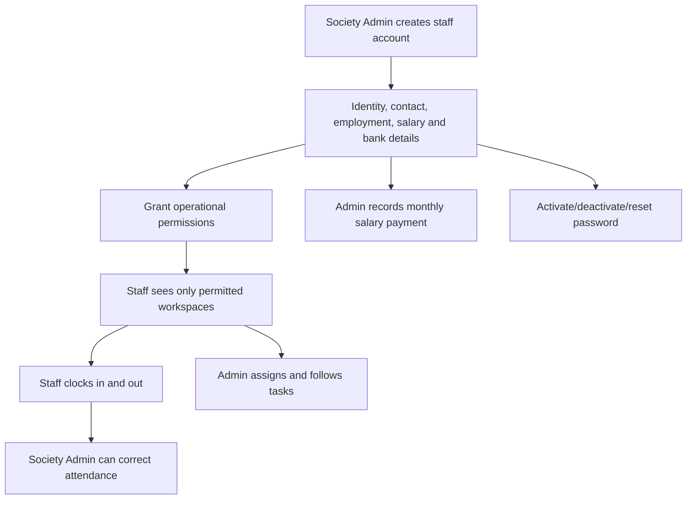

## 10. Society finance, maintenance and payment flow

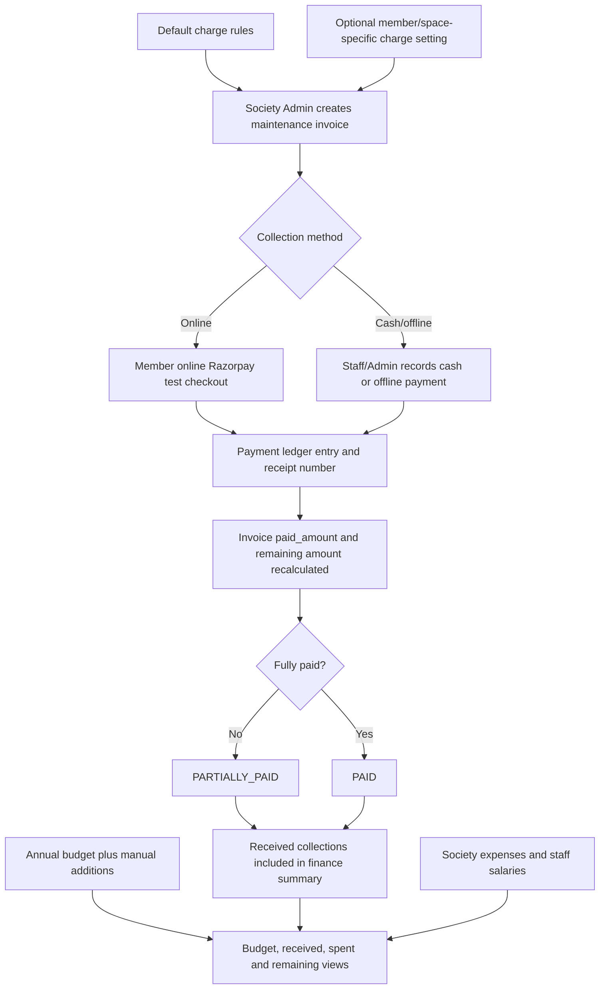

`remaining = invoice total - valid paid amount`; it is bounded so overpayment does not produce a
misleading negative amount. Society budget additions are explicitly auditable records.

## 11. Complaints and staff tasks

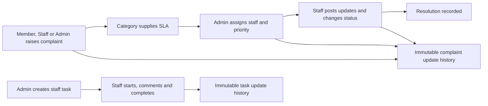

## 12. Visitor flow

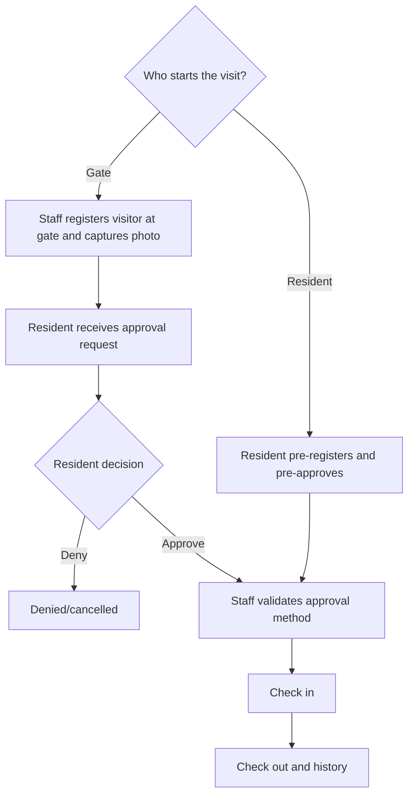

Visitor photos are files on disk; `visitor_photos` stores the secured path and content type.

## 13. Amenities flow

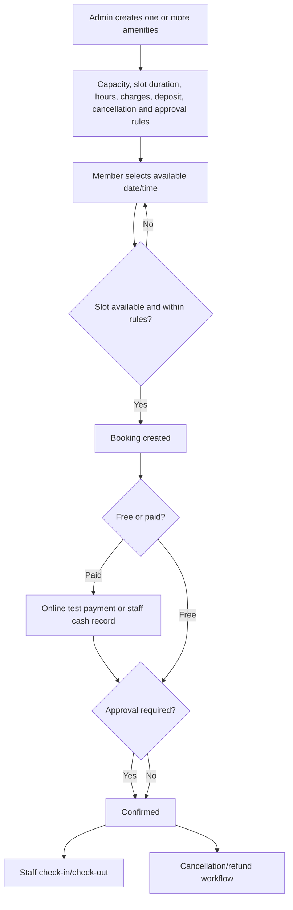

Each physical gym, swimming pool, community hall, or other facility is a separate `amenities`
record, so a society can manage multiple facilities of the same type.

## 14. Activities and galleries flow

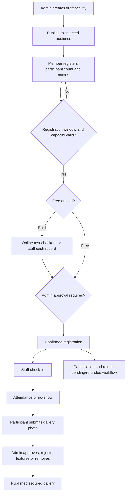

Activity event history records lifecycle, registration, attendance, refund and gallery moderation
actions.

## 15. Delivery flow

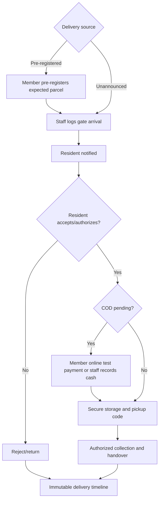

## 16. Emergency and accident flow

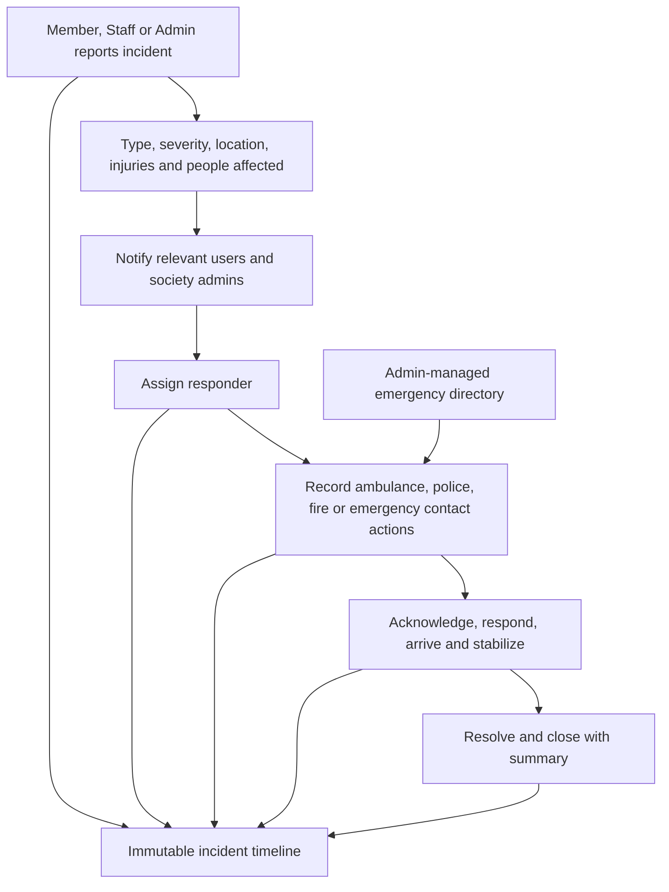

## 17. Notices, documents, support and platform operations

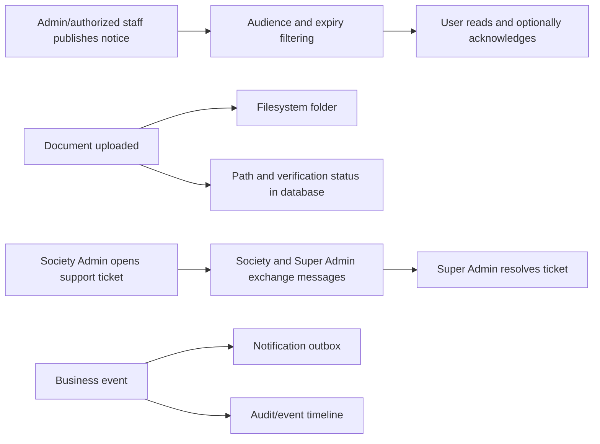

## 18. File-storage flow

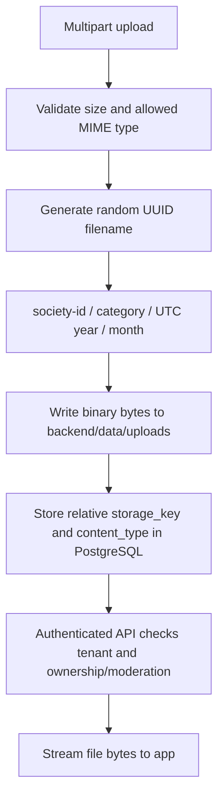

Example:

```text
backend/data/uploads/
└── 11111111-1111-1111-1111-111111111111/
    ├── images/2026/07/550e8400-e29b-41d4-a716-446655440000.png
    ├── videos/2026/07/550e8400-e29b-41d4-a716-446655440001.mp4
    └── documents/2026/07/550e8400-e29b-41d4-a716-446655440002.pdf
```

## 19. One logical database structure

The application uses one logical PostgreSQL database named `societydb`. The migration catalog through V54 has
64 application tables, 143 foreign-key constraints, and the Flyway-managed
`flyway_schema_history` table. PostgreSQL internally
maintains multiple physical files; those files are implementation details and must never be
manually combined or edited.

Rendered database charts:

- [Complete database structure — PNG](diagrams/complete_database_structure_flowchart.png)
- [Complete database structure — zoomable SVG](diagrams/complete_database_structure_flowchart.svg)

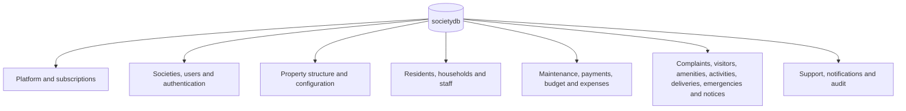

There are 64 application tables plus `flyway_schema_history`. The following diagrams are views
of that same database, divided only for readability.

### 19.1 Core identity, society and subscription relationships

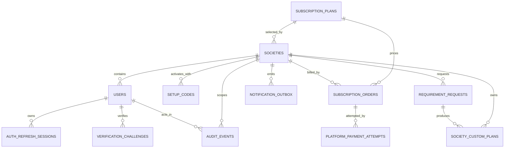

`platform_services` is the global service catalog. Selected service codes are stored as JSON in
`societies.enabled_modules` and in custom-plan/request records rather than as foreign-key rows.

### 19.2 Property, resident and household relationships

```mermaid
erDiagram
    SOCIETIES ||--o{ BLOCKS : has
    BLOCKS ||--o{ FLOORS : contains
    FLOORS ||--o{ FLATS : contains
    USERS ||--o{ FLATS : active_owner
    USERS ||--o{ FLATS : active_tenant
    SOCIETIES ||--o{ RESIDENT_REGISTRATIONS : receives
    FLATS ||--o{ RESIDENT_REGISTRATIONS : requested_for
    RESIDENT_REGISTRATIONS ||--o{ RESIDENT_DOCUMENTS : includes
    USERS ||--o{ HOUSEHOLD_MEMBERS : primary_resident
    USERS ||--o{ HOUSEHOLD_VEHICLES : primary_resident
    USERS ||--o{ HOUSEHOLD_EMERGENCY_CONTACTS : primary_resident
    SOCIETIES ||--o{ PARKING_SLOTS : configures
    FLATS ||--o{ PARKING_SLOTS : allocated_to
```

### 19.3 Staff relationships

```mermaid
erDiagram
    USERS ||--o| STAFF_PROFILES : has
    USERS ||--o{ STAFF_PERMISSIONS : granted_to
    USERS ||--o{ STAFF_ATTENDANCE : attends
    USERS ||--o{ STAFF_SALARY_PAYMENTS : paid_to
    SOCIETIES ||--o{ STAFF_ATTENDANCE : scopes
    SOCIETIES ||--o{ STAFF_SALARY_PAYMENTS : pays
    SOCIETIES ||--o{ STAFF_TASKS : owns
    USERS ||--o{ STAFF_TASKS : assigned_to
    STAFF_TASKS ||--o{ STAFF_TASK_UPDATES : history
```

### 19.4 Society finance relationships

```mermaid
erDiagram
    SOCIETIES ||--o{ MAINTENANCE_CHARGE_RULES : configures
    SOCIETIES ||--o{ MEMBER_CHARGE_SETTINGS : overrides
    FLATS ||--o{ MEMBER_CHARGE_SETTINGS : charged_for
    SOCIETIES ||--o{ MAINTENANCE_INVOICES : issues
    FLATS ||--o{ MAINTENANCE_INVOICES : billed_to
    MAINTENANCE_INVOICES ||--o{ PAYMENTS : receives
    USERS ||--o{ PAYMENTS : pays_or_records
    SOCIETIES ||--o{ SOCIETY_PAYMENT_SETTINGS : settles_to
    SOCIETIES ||--o{ SOCIETY_BUDGETS : plans
    SOCIETIES ||--o{ SOCIETY_BUDGET_ADDITIONS : supplements
    SOCIETIES ||--o{ SOCIETY_EXPENSES : spends
    USERS ||--o{ SOCIETY_EXPENSES : records
```

### 19.5 Operational relationships

```mermaid
erDiagram
    SOCIETIES ||--o{ COMPLAINTS : owns
    COMPLAINT_CATEGORIES ||--o{ COMPLAINTS : classifies
    COMPLAINTS ||--o{ COMPLAINT_UPDATES : history

    SOCIETIES ||--o{ VISITORS : receives
    USERS ||--o{ VISITORS : hosts
    VISITORS ||--o{ VISITOR_PHOTOS : has

    SOCIETIES ||--o{ AMENITIES : configures
    AMENITIES ||--o{ AMENITY_BOOKINGS : booked_as
    USERS ||--o{ AMENITY_BOOKINGS : books

    SOCIETIES ||--o{ SOCIETY_ACTIVITIES : organizes
    SOCIETY_ACTIVITIES ||--o{ ACTIVITY_PARTICIPATIONS : registrations
    SOCIETY_ACTIVITIES ||--o{ ACTIVITY_GALLERY_PHOTOS : gallery
    SOCIETY_ACTIVITIES ||--o{ ACTIVITY_EVENTS : history

    SOCIETIES ||--o{ DELIVERIES : receives
    DELIVERIES ||--o{ DELIVERY_EVENTS : history

    SOCIETIES ||--o{ EMERGENCY_INCIDENTS : handles
    EMERGENCY_INCIDENTS ||--o{ EMERGENCY_INCIDENT_EVENTS : history
    SOCIETIES ||--o{ EMERGENCY_DIRECTORY_CONTACTS : directory

    SOCIETIES ||--o{ NOTICES : publishes
    NOTICES ||--o{ NOTICE_READS : read_by
    USERS ||--o{ NOTICE_READS : reads
```

### 19.6 Documents and support relationships

```mermaid
erDiagram
    SOCIETIES ||--o{ SOCIETY_DOCUMENTS : owns
    RESIDENT_REGISTRATIONS ||--o{ RESIDENT_DOCUMENTS : owns
    SOCIETIES ||--o{ SUPPORT_TICKETS : opens
    USERS ||--o{ SUPPORT_TICKETS : creates
    SUPPORT_TICKETS ||--o{ SUPPORT_TICKET_MESSAGES : conversation
    USERS ||--o{ SUPPORT_TICKET_MESSAGES : sends
```

### 19.7 Storage quota and file relationships

```mermaid
erDiagram
    USERS ||--o{ STORAGE_POLICIES : updates
    SOCIETIES ||--|| SOCIETY_STORAGE_ACCOUNTS : receives_allowance
    SOCIETIES ||--o{ STORAGE_ADDON_PURCHASES : buys
    USERS ||--o{ STORAGE_ADDON_PURCHASES : purchases
    SOCIETIES ||--o{ STORAGE_OBJECTS : owns
    USERS ||--o{ STORAGE_OBJECTS : deletes

    SOCIETY_DOCUMENTS ||--o| STORAGE_OBJECTS : meters_file
    RESIDENT_DOCUMENTS ||--o| STORAGE_OBJECTS : meters_file
    VISITOR_PHOTOS ||--o| STORAGE_OBJECTS : meters_file
    ACTIVITY_GALLERY_PHOTOS ||--o| STORAGE_OBJECTS : meters_file
```

The last four links are logical ownership links represented by `storage_objects.owner_type` and
`owner_id`, not physical SQL foreign keys, because one quota ledger supports several file-owning
table types. Unlinked legacy objects remain metered but protected from unsafe cleanup.

## 20. Complete table catalog

| Domain | Tables | Purpose |
| --- | --- | --- |
| Platform/core | `subscription_plans`, `platform_services`, `societies`, `users`, `auth_refresh_sessions`, `verification_challenges`, `setup_codes`, `audit_events`, `notification_outbox` | Platform configuration, tenants, identities, sessions, activation, audit and delivery queue |
| Requirements/subscriptions | `requirement_requests`, `society_custom_plans`, `subscription_orders`, `platform_payment_settings`, `platform_payment_attempts`, `razorpay_webhook_events` | Custom sales requirements, society-to-platform billing, provider attempts and webhook idempotency |
| Structure/configuration | `blocks`, `floors`, `flats`, `parking_slots`, `vendors`, `complaint_categories`, `maintenance_charge_rules` | Property hierarchy and society master configuration |
| Resident/household | `resident_registrations`, `resident_documents`, `household_members`, `household_vehicles`, `household_emergency_contacts` | Resident approval, occupancy and household information |
| Staff | `staff_profiles`, `staff_permissions`, `staff_attendance`, `staff_salary_payments`, `staff_tasks`, `staff_task_updates` | Staff identity, authorization, attendance, salary and work |
| Society finance | `member_charge_settings`, `maintenance_invoices`, `payments`, `society_payment_settings`, `society_budgets`, `society_budget_additions`, `society_expenses` | Resident billing, collections, receipts, budget and spending |
| Complaints | `complaints`, `complaint_updates` | Service requests, SLA, assignment and history |
| Visitors | `visitors`, `visitor_photos` | Approval, gate lifecycle and filesystem photo references |
| Notices | `notices`, `notice_reads` | Audience-targeted publishing, reads and acknowledgement |
| Amenities | `amenities`, `amenity_bookings` | Multiple facilities, availability, booking, payment and usage |
| Activities | `society_activities`, `activity_participations`, `activity_gallery_photos`, `activity_events` | Free/paid events, registration, attendance, gallery and history |
| Deliveries | `deliveries`, `delivery_events` | Parcel lifecycle, COD, pickup security and history |
| Emergency | `emergency_directory_contacts`, `emergency_incidents`, `emergency_incident_events` | Emergency directory, response state and history |
| Documents | `society_documents` | Society document path and verification metadata |
| Support | `support_tickets`, `support_ticket_messages` | Society-to-platform support conversation |
| Storage quota | `storage_policies`, `society_storage_accounts`, `storage_addon_purchases`, `storage_objects` | Free allowance, paid recurring capacity, byte-level metering, ownership and cleanup lifecycle |
| Schema management | `flyway_schema_history` | Applied database migration versions; managed only by Flyway |

## 21. Important database conventions

- Primary business identifiers are UUIDs; the audit table uses a numeric sequence.
- `society_id` is the tenant boundary. Services always scope society operations using the
  authenticated society rather than trusting a client-supplied tenant.
- Monetary values use PostgreSQL `numeric`, not floating-point types.
- Lifecycle state is stored in explicit `status` fields and changed through service rules.
- Event/update tables preserve important history rather than overwriting the only record.
- JSONB is reserved for variable platform data such as module lists, audit details and
  notification payloads.
- Passwords, setup codes, refresh tokens and invitation tokens are stored as hashes.
- Binary uploads are not database columns. Only relative paths such as `storage_key` are stored.
- Flyway migrations are the only supported way to change the schema.

## 22. Backup and restore as one application

The application has two persistent assets that must be backed up together:

```mermaid
flowchart LR
    Backup["SocietyHub backup"]
    Dump["PostgreSQL pg_dump file"]
    Uploads["backend/data/uploads archive"]
    Restore["Restore database and matching upload folder"]

    Backup --> Dump
    Backup --> Uploads
    Dump --> Restore
    Uploads --> Restore
```

Never copy PostgreSQL's internal physical files while it is running. Use `pg_dump`/`pg_restore`
for the database and a normal filesystem backup for uploads.

## 23. Current external-integration boundary

The internal application workflows are complete enough for functional testing, but these pieces
must be connected before real production money or messages are used:

- Platform membership has a production Razorpay adapter, signed webhooks, idempotent attempts and
  reconciliation. Live charging still requires account credentials and Dashboard webhook setup.
- Society-level maintenance, amenity, activity and delivery collection remains test-only; a
  connected-account/settlement design is required before accepting money for individual societies.
- Notification records use an outbox; production SMS, email, WhatsApp or push delivery requires
  provider adapters and a durable dispatcher.
- Local filesystem uploads are appropriate for the current single backend. Multiple production
  backend instances should use a shared durable filesystem or object storage while keeping the
  same database metadata model.
- Production operations require automated PostgreSQL and upload-folder backups, monitoring,
  malware scanning, retention rules and secret management.

## 24. Source locations

| Area | Location |
| --- | --- |
| Backend controllers | `backend/src/main/java/com/societyapp/controller` |
| Business services | `backend/src/main/java/com/societyapp/service` |
| Database entities | `backend/src/main/java/com/societyapp/entity` |
| Database migrations | `backend/src/main/resources/db/migration` |
| Shared Flutter workspaces | `packages/society_ui/lib/src` |
| Super Admin app | `apps/super_admin` |
| Society Admin app | `apps/society_admin` |
| Staff app | `apps/staff` |
| Member app | `apps/member` |
| Public onboarding | `frontend` |
| Uploaded files | `backend/data/uploads` |
