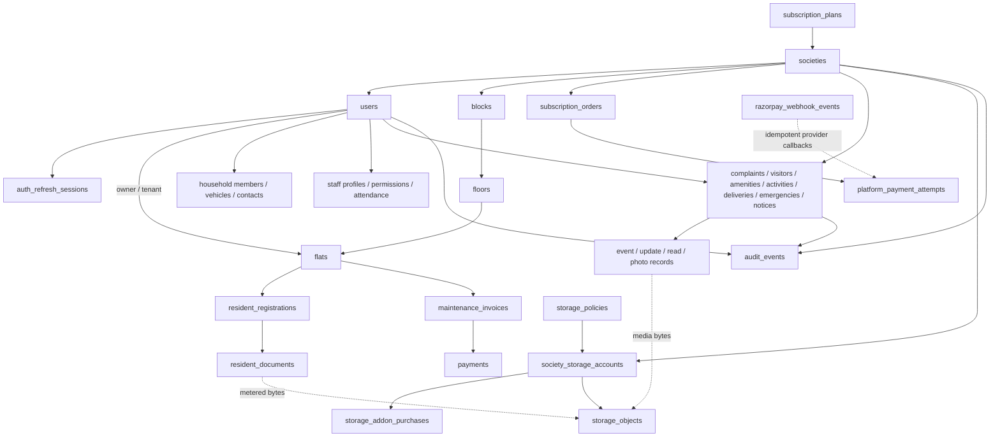

# Complete Database Structure Flowchart

This chart describes the PostgreSQL `societydb` schema for the migration catalog through Flyway V54.

- **64 application tables**
- **143 physical foreign-key constraints**
- **1 Flyway schema-history table**
- **1 logical shared database** with tenant isolation through `society_id`

## Visual assets

- [High-resolution PNG](diagrams/complete_database_structure_flowchart.png)
- [Zoomable/editable SVG](diagrams/complete_database_structure_flowchart.svg)

## Relationship backbone

## Key rules

- `societies` is the tenant root and `users` is the identity/actor root.
- Property follows `blocks → floors → flats`; API terminology exposes these as property groups,
  optional sections, and spaces.
- Tenant services derive `society_id` from the authenticated user rather than trusting request
  data.
- Financial values use `numeric`; business identifiers use UUIDs.
- Update/event tables preserve lifecycle history and `audit_events` records successful mutations.
- PostgreSQL stores file metadata and storage keys; physical bytes remain in the upload/object
  storage layer and are metered by `storage_objects`.
- Flyway migrations are the only supported schema-change mechanism.

For detailed per-domain ER diagrams and the full table catalog, see
[Complete Application Flow and Database Structure](COMPLETE_APPLICATION_FLOW_AND_DATABASE.md#19-one-logical-database-structure).
